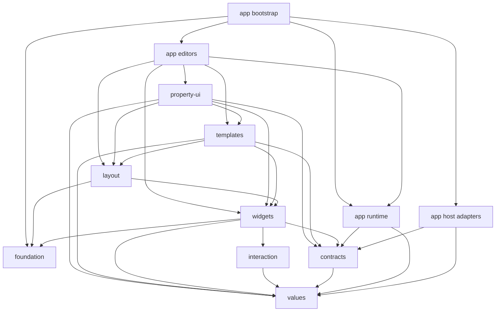

# Pivot UI 基于 Blender 5.2 LTS 的重构方案

> 本文是已采纳的迁移设计与原始组件处置快照。旧源码路径用于追溯，可从对应批次 Git 提交查看；B11 后的当前接入方式见 [最终指南](../refactor/blender-5.2/B11_INTEGRATION.md)，完成状态见 [实施台账](../refactor/blender-5.2/LEDGER.md)。

日期：2026-10-22。状态：已采纳，按批次推进。盘点基线：当前工作树，包含尚未提交的 FormItem 修复及 GUI、GUIRoot、旧 Panel 删除。

工作分支：`feat-blender-5-2-refactor`。实施范围与顺序见 [批次计划](D:/QtProject/editor-ui-custom/docs/refactor/blender-5.2/BATCHES.md)，实际进度、验证和提交见 [实施台账](D:/QtProject/editor-ui-custom/docs/refactor/blender-5.2/LEDGER.md)。

本次重构统一界面术语、组件职责、状态归属和依赖方向，取消现有 `ui/gui` 的架构划分。所有现有组件均纳入评估，允许调整名称、接口和内部实现。保留可用的交互能力；需要独立变化的数值模型、交互行为、界面组合和宿主能力分别组织。

本方案覆盖当前全部公开组件、相关公共工具与类型，以及影响拆分的内部零件。实现和包迁移按批次推进；业务页面开发保持在本轮重构范围之外。

## 1 目标与范围

### 1.1 对齐目标

- **概念对齐**：Property、Operator、Panel、Editor、Region 等采用 Blender 的含义；项目新增概念明确标注。
- **职责对齐**：属性描述、属性访问、控件交互、界面布局、应用功能、宿主集成具有清晰边界。
- **交互对齐**：数值拖动即时反馈、明确的提交与取消、连续编辑事务、键盘操作、统一字段布局和状态表现。
- **实现适配**：继续使用 React、TypeScript、Radix 和 Panda；C++ 与 Qt 接入通过明确的契约完成。

Blender 手册与 API 使用固定的 **5.2** 文档，源码依据固定的 **v5.2.0** 标签。开发者架构文档作为补充说明，不把滚动更新的文档或源码主分支当作 5.2 的版本快照。

### 1.2 本轮重构交付边界

交付统一的组件包、清晰的组合 API、值类型与编辑生命周期、属性绑定的最小接口和可运行的 Storybook 场景。组件应既能直接使用受控值，也能由属性适配层驱动。

应用级 Properties Editor、Outliner、Asset Browser、工作区拆分管理、完整 Operator/Undo 系统属于后续应用开发。此次定义其边界并提供最小模拟实现，避免组件接口提前依赖尚未存在的后端。

DNA、RNA、依赖图、完整动画系统和 Blender Python 注册机制均有各自的实现背景。本项目借鉴相应职责，不在本轮复制这些系统。

## 2 团队术语表

### 2.1 Blender 概念

| 术语                     | 团队统一理解                                                                                 | 对当前项目的约束                                                                                        |
| ------------------------ | -------------------------------------------------------------------------------------------- | ------------------------------------------------------------------------------------------------------- |
| Workspace 工作区         | 围绕工作任务组织的一组 Area 和 Editor 布局。                                                 | 未来应用壳负责；组件库中的 Flex、ResizableSplit 不承担工作区保存与切换。                                |
| Area 区域                | 为 Editor 分配屏幕空间的矩形区域。                                                           | 与普通 HTML 容器区分；布局系统负责尺寸与分割关系。                                                      |
| Editor 编辑器            | 完整功能界面，例如 Properties、Outliner、Graph Editor。                                      | 名称 `*Editor` 优先留给应用功能；单个曲线编辑控件采用 `CurveWidget`。                                   |
| Region 编辑器区域        | Editor 内的 Header、Main、Sidebar、Toolbar 等区域。                                          | 与 Area 区分；Region 组织功能内容，不参与业务数据存储。                                                 |
| Panel 面板               | Region 中按功能组织的界面分组；Blender Panel 可声明目标编辑器、区域、显示条件和子面板关系。  | 普通折叠容器使用 Collapsible 或 Section；未来语义 Panel 由应用组织。旧可拖动 Panel 保持删除。           |
| UILayout 界面布局        | 在面板、标题栏等位置组织控件、属性呈现与操作入口；包含 row、column、split、box 等组合方式。  | 使用 React 组合和布局组件落实；与工作区停靠、窗口管理区分。                                             |
| Widget / Control 控件    | 完成具体显示或输入交互的界面元素。                                                           | Button、InputNumber、Checkbox、Slider 等在这一职责范围。                                                |
| UI Template 复合界面构建 | 复用一组有共同目的的界面元素，例如颜色带、曲线或数据选择界面。                               | 可采用复合 React 组件；允许复杂组合存在，内部依赖须清晰。                                               |
| Property 属性            | 数据成员及其类型、范围、单位、可编辑性等描述，与值的访问方式。                               | 数据属性与其某个控件呈现分开；同一属性可在不同位置用不同控件编辑。                                      |
| RNA                      | 描述结构化数据并提供反射、访问、更新等能力的系统。                                           | 参考其属性描述思想；本项目采用自己的 PropertyDescriptor/PropertyAccess 契约，不将 Qt 通信层命名为 RNA。 |
| Operator 操作            | 可从按钮、菜单、快捷键等触发的操作，具有标识、参数、可执行条件和执行过程，可参与撤销等机制。 | 删除、导入、定位等由应用动作层组织；基础 Button 接收状态与回调。                                        |
| Context 上下文           | 操作和界面所处的窗口、编辑器、活动对象、选择、模式等环境。                                   | 应用维护明确的上下文快照；React Context 只是可能的传递机制。                                            |
| Keymap 键位映射          | 将输入事件与操作联系起来，并考虑适用上下文。                                                 | 应用负责快捷键分发；Kbd 只展示快捷键。                                                                  |
| Theme 主题               | 控件、编辑器等界面的视觉配置。                                                               | 统一 token 和主题状态；明暗主题与渲染色彩空间分别处理。                                                 |

窗口术语依据 [Workspaces](https://docs.blender.org/manual/en/5.2/interface/window_system/workspaces.html)、[Areas](https://docs.blender.org/manual/en/5.2/interface/window_system/areas.html)、[Regions](https://docs.blender.org/manual/en/5.2/interface/window_system/regions.html) 与 [Panel API](https://docs.blender.org/api/5.2/bpy.types.Panel.html)。界面组合依据 [UILayout API](https://docs.blender.org/api/5.2/bpy.types.UILayout.html)；数据与动作依据 [RNA](https://developer.blender.org/docs/features/core/rna/)、[Operator API](https://docs.blender.org/api/5.2/bpy.types.Operator.html)、[Context API](https://docs.blender.org/api/5.2/bpy.types.Context.html) 与 [默认键位说明](https://docs.blender.org/manual/en/5.2/interface/keymap/blender_default.html)。

### 2.2 本项目新增概念

以下是本项目的 React 实现约定，不是 Blender 官方类名或正式分层。

| 项目术语                             | 职责                                                                     | 命名约束                                                                   |
| ------------------------------------ | ------------------------------------------------------------------------ | -------------------------------------------------------------------------- |
| PropertyRow                          | 标签、说明、状态、控件区域的布局与可访问关联。                           | 不包含 value、对象路径、数据读写或控件类型判断。                           |
| PropertyField                        | 连接 PropertyDescriptor、PropertyAccess 与具体控件的薄适配。             | 可显式指定控件；不负责生成整个应用，不恢复 GUIRoot。                       |
| Section                              | 通用标题、折叠和内容分组。                                               | 不自带编辑器注册、对象上下文或 Panel 生命周期。                            |
| Template                             | 可复用的复合编辑界面，例如 VectorInput、ColorInput、CollectionTemplate。 | 通过值与回调使用，不直接访问应用状态或 Qt。                                |
| ResourceDescriptor / AssetDescriptor | 资源项的纯展示数据，包括标识、名称、种类、缩略图和可选择状态等。         | 不携带引擎实例方法；与 Blender Data-Block 的完整语义不作等同。             |
| EditSession                          | 一次连续编辑的开始、预览更新、提交或取消。                               | 用于协调控件、属性状态与未来撤销，不要求每次 pointermove 都执行 Operator。 |
| HostCapabilities                     | 宿主提供的吸管、剪贴板、文件选择、偏好存储等能力。                       | 由应用注入；组件按可用性显示或禁用对应入口。                               |

`PropertyField` 专指属性编辑适配，避免与 Geometry Nodes 的 Field 概念混用。组件族内部的 `Root/Trigger/Content` 表示组合部件，继续允许使用；已经移除的 GUIRoot 是另一种全局组织抽象。

### 2.3 容易混淆的现有名称

| 当前名称或理解                             | 重构后的约定                                                                                      |
| ------------------------------------------ | ------------------------------------------------------------------------------------------------- |
| `@pivot-ui/editor` 包中所有组件都是 Editor | 包改为中性名称 `@pivot-ui/react`；Editor 留给完整应用功能。                                       |
| `ui` 低层、`gui` 高层                      | 按 widgets、layout、templates、property-ui 等职责组织。                                           |
| `FormItem*` 是所有属性编辑的固定单位       | 拆成布局、控件、复合模板和属性绑定；旧包装 API 随迁移删除。                                       |
| `BezierCurveEditor`                        | 拆成内联 `CurveWidget`、弹出组合 `CurvePicker` 和外部预设服务。                                   |
| `ResizablePanel`                           | 重写为 `ResizableSplit`，负责可调整的布局尺寸。                                                   |
| `ParticleSlider`                           | 当前能力是 RGB/alpha 分轨渐变编辑，改为明确的颜色轨道名称，例如 `ColorRampChannels`。             |
| `FormItemParticle`                         | 属于项目的数值分布模式组合，改为 `NumericDistributionTemplate`；不宣称是 Blender 的粒子系统接口。 |

Blender v5.2.0 的 widgets、layout、templates 同属共享界面模块；这些名称不意味着必须拆成独立发布包。[固定版本的界面模块清单](https://raw.githubusercontent.com/blender/blender/v5.2.0/source/blender/editors/interface/CMakeLists.txt)

## 3 职责和依赖关系

### 3.1 模块职责

下表是目标结构。模块边界先在一个组件包内建立；应用服务和宿主适配留在应用层。

| 模块          | 负责                                                                                  | 允许依赖                                                     | 不应承担                                  |
| ------------- | ------------------------------------------------------------------------------------- | ------------------------------------------------------------ | ----------------------------------------- |
| values        | 数值约束、颜色值、颜色转换、曲线与渐变数据及纯算法。                                  | 纯工具库。                                                   | React、DOM、存储、应用对象。              |
| contracts     | 属性描述、属性访问、编辑事务、能力接口的类型。                                        | values 的纯类型。                                            | 控件、全局状态、桥接实现。                |
| foundation    | token、排版、图标、主题应用机制和共享视觉规则。                                       | React/Panda、轻量第三方基础。                                | 业务状态、全局偏好持久化策略。            |
| interaction   | 指针拖动、键盘、内联编辑、拖放等可复用交互行为。                                      | React、平台输入 API、values。                                | 属性路径、引擎对象、资源查询。            |
| widgets       | 基础输入、展示、集合与浮层组件族。                                                    | foundation、interaction、values；必要的 contracts 能力类型。 | 属性服务、Operator 注册、Qt 实现。        |
| layout        | Flex、PropertyRow、Section、可调整分隔布局。                                          | foundation；按需组合 widgets。                               | 字段值解析、颜色/粒子专属布局规则。       |
| templates     | VectorInput、ColorInput、ColorRamp、CurvePicker、ResourcePicker、数值分布等复合界面。 | widgets、layout、values、contracts 类型。                    | 应用服务实例、持久化策略、引擎 DTO 转换。 |
| property-ui   | 属性描述/状态到控件 props 的适配，属性行呈现，编辑事务连接。                          | contracts、values、widgets、layout、templates。              | 任意业务页面生成、宿主连接建立。          |
| app/runtime   | 属性状态、对象选择、Context、动作注册/执行、编辑事务与宿主更新协调。                  | contracts、values。                                          | React 控件、DOM 查找。                    |
| app/editors   | Properties、Outliner 等完整界面及领域面板组合。                                       | runtime 与组件包的公开 API。                                 | 在通用控件内部加入业务判断。              |
| app/host      | Mock、浏览器能力和未来 Qt/C++ 适配。                                                  | contracts、values；具体平台 API。                            | 组件渲染。                                |
| app/bootstrap | 创建服务、选择宿主实现、注入 Provider、挂载应用。                                     | runtime、host、editors、foundation。                         | 被下层模块反向导入。                      |

### 3.2 依赖图

箭头表示“左侧代码可以导入右侧模块”，不是运行时消息方向。



同层模块通过显式接口组合；共享代码提取到更低层，不建立反向 import。例如颜色算法放 values/color，ColorRamp 和 ColorInput 都使用它，颜色轨道不再从 ColorPicker 目录导入自己的基础模型。

颜色组合固定三个角色：`ColorWidget` 是单个颜色的独立内联编辑主体，支持明确的普通/HDR 值；`ColorPicker` 用触发器和 Popover 包装 ColorWidget；`ColorInput` 是紧凑字段组合，组织 HEX、Alpha 和 ColorPicker。依赖顺序为 `ColorInput → ColorPicker → ColorWidget`，后者不反向引用前者；三者均可通过受控值独立组合。

原 ColorPicker 的 gradient/particle 模式迁入独立的 ColorRamp 及其弹出组合。ColorRamp 可调用单色 ColorPicker 编辑某个停靠点；单色 ColorPicker 不再依赖 ColorRamp，避免颜色模板之间形成循环。

runtime 依赖接口，具体 host 实现由 bootstrap 注入。控件可以接收能力函数，但不会导入 `QtAdapter` 或 Mock 服务。React Provider 的嵌套关系不改变上述代码依赖。

### 3.3 状态归属

| 状态                               | 所有者                             | 示例                                        |
| ---------------------------------- | ---------------------------------- | ------------------------------------------- |
| 编辑草稿、焦点、拖动起点、浮层开关 | 控件；提供需要的受控入口。         | 尚未完成的 `-`、小数输入、颜色停靠点拖动。  |
| 属性的当前有效值、校验状态、版本   | PropertyAccess/runtime。           | 对象 location、材质颜色、资源引用。         |
| 选中对象、活动 Editor、模式        | 应用 Context。                     | Properties 显示哪个对象。                   |
| 模式切换后的缓存                   | 模式组合的显式 UI 状态或应用状态。 | constant 切到 curve，再切回时是否保留原值。 |
| 列表显示模式、主题偏好、曲线预设   | 应用偏好/预设服务。                | localStorage 只作为一种可替换实现。         |
| 异步操作、确认弹层队列、宿主能力   | runtime 或应用级服务。             | 导入资源、删除确认、吸管取色。              |

## 4 属性编辑和宿主接入约定

### 4.1 属性描述和控件呈现

`PropertyDescriptor` 至少表达稳定标识、值类型、标签/说明、范围、单位、精度、选项、是否可编辑及原因。元数据可以来自前端配置，也可以由未来的 C++ 服务提供。

描述采用明确的类型分支，例如 number、boolean、string、enum、numeric tuple、color、resource reference。控件呈现可由面板显式指定；只在已知类型范围内提供默认映射。布局组合始终允许手写。

`PropertyAccess` 负责读取快照、订阅更新和发起编辑。属性引用需要对象标识与属性标识；基础控件不持有对象路径，也不通过字符串路径直接修改对象。

Blender 的对象面板本身也会组合属性和操作入口；本项目借鉴这种组合方式。[v5.2.0 对象面板源码](https://raw.githubusercontent.com/blender/blender/v5.2.0/scripts/startup/bl_ui/properties_object.py)

### 4.2 连续编辑生命周期

建议统一语义为 `begin → change* → commit | cancel`。具体 props 名称在实现阶段保持一致，例如 `onEditStart`、`onValueChange`、`onEditEnd`，提交结果明确区分 commit 与 cancel。

1. 开始编辑时捕获目标属性、初始值和版本，建立 EditSession。
2. 拖动期间立即更新前端显示并连续发出值变化；传输节流由适配层决定，不阻塞界面反馈。
3. 提交一次连续编辑时产生一个逻辑事务；未来撤销不会为每次鼠标移动分别记录历史。
4. 取消时撤销当前事务的预览。若存在宿主外部更新，通过版本规则协调，避免直接把新值覆盖成旧快照。
5. 目标对象切换、控件卸载或失去编辑能力时显式结束会话；提交目标采用开始时捕获的引用。
6. 异步宿主返回规范化值、校验失败或过期版本时，runtime 更新有效值和错误状态；过期响应不能覆盖较新的编辑。

纯展示或简单按钮无须人为套入编辑事务。文本控件保留可表达中间输入的草稿，业务有效值按约定更新。禁止通过伪造 React 输入事件在拖动、文本输入之间转发数值。

会话结束规则作为阶段 A 的固定契约：

| 结束原因                                               | 默认结果                                                                                |
| ------------------------------------------------------ | --------------------------------------------------------------------------------------- |
| 有效文本按 Enter，或文本控件正常 blur                  | commit；blur 与 Enter 不能重复结束同一会话。                                            |
| 拖动后 pointerup，或离散步进操作完成                   | commit；无有效值变化时不产生历史记录。                                                  |
| Escape、pointercancel、拖动期间窗口失焦                | cancel；撤销本会话的预览。                                                              |
| 活动对象切换、编辑中的控件卸载、变为 disabled/readOnly | cancel 当前仍在编辑的会话。                                                             |
| 明确提交后异步确认仍在等待，随后界面卸载或切换对象     | 保留已提交请求，由 runtime 对原目标处理结果，不将响应应用到新目标。                     |
| 同一属性收到其它来源的较新版本                         | cancel 未提交会话并接受新版本；不写回旧起点。自己的预览确认通过 sessionId/source 识别。 |
| 提交被拒绝或版本过期                                   | 接受最新权威值并呈现原因，允许新建会话重试；不自动覆盖外部更改。                        |

同一 session 只能终结一次，重复 close/blur/cancel 为幂等操作。宿主的取消操作只撤销该 session 的预览；不能以“写回初始值”覆盖另一来源已经确认的更新。上述冲突处理先在 Mock 中实现可验证行为，再映射到真实宿主事务能力。

### 4.3 数字、选择和复合值

- **数值**：区分 hard range 与 soft range、step 与 dragStep、精度与显示格式、存储单位与显示单位。硬限制适用于最终有效值；软限制用于交互调整。数值拖动、键盘输入和细调行为以 [5.2 输入字段说明](https://docs.blender.org/manual/en/5.2/interface/controls/buttons/fields.html) 为参照。表达式输入需要独立解析器与明确语法，后续迭代实现，禁止直接执行任意代码。
- **选择**：内部选项使用稳定 key，原始值从映射表恢复；不通过 `String(value)` 后猜测数字类型。单选、多选、单选必选和可取消选择分别声明，Select、SegmentControl、ToggleGroup 可以共享选项类型，但保持各自交互语义。
- **向量与矩形**：统一数值元组输入内核；Vector2/3/4 保持维度语义，Rect 保持位置与尺寸语义。比例锁定独立于输入控件，明确零轴、范围限制和拖动起点。
- **颜色**：新的值类型明确通道范围、alpha 和色彩空间；显示编码与存储编码显式转换。HDR 允许有效的 RGB 超出标准显示范围。现有 sRGB/Linear 转换保留为有限能力，完整渲染显示变换由宿主色彩管理决定。
- **渐变与曲线**：属性值包含稳定的点标识、位置和插值数据。`selectedPointIds`、`activeStopId`、视口缩放等属于可受控 UI 状态，单纯选点不触发属性写入或撤销记录。颜色、alpha 分轨可组合；引擎的 `time ↔ position` 转换留在适配层。当前贝塞尔/线性能力的迁移不代表实现 Blender 全部 Curve Mapping 或 Graph Editor 行为。
- **数值分布模式**：用判别联合表示当前生效的 constant、curve、two-constant、two-curve 等值；模式缓存单独保存，取消“所有模式值数组 + 独立 type + any”的核心契约。

### 4.4 C++ 和 Qt 边界

| 接口方向 | 约定                                                                           |
| -------- | ------------------------------------------------------------------------------ |
| 属性访问 | 使用纯数据快照、属性标识和版本；组件不接收带引擎方法的对象。                   |
| 动作执行 | 以动作标识与参数表达请求；应用统一可用性、busy、结果与错误。                   |
| 资源查询 | Provider 返回 AssetDescriptor、分页/分组及加载状态；选择结果使用稳定资源标识。 |
| 平台能力 | 吸管、剪贴板、文件选择、偏好、预设等通过可选能力注入；缺失能力有明确呈现。     |
| 原生视口 | 应用壳通过独立 ViewportHost 接口协调可见性、尺寸、焦点和宿主事件。             |

先以本地状态实现 MockPropertyAccess、MockOperators、MockResourceProvider，允许模拟延迟、拒绝、外部更新和能力缺失。未来 Qt 适配实现相同语义；具体采用何种进程通信或嵌入方式，在原生集成阶段确定。

中央 3D 内容由 Qt 原生窗口渲染。前端原型可以使用占位视口表达位置和状态；原生视口与 DOM 浮层的遮挡、焦点、坐标与缩放关系，需要在接入阶段专门验证。

## 5 当前组件完整处置清单

### 5.1 统计口径与动作含义

当前 [UI 根入口](D:/QtProject/editor-ui-custom/packages/ui/src/index.ts) 导出 **42 个组件模块族**，此外还有 hooks、utils、样式工具和类型。当前 [GUI 组件入口](D:/QtProject/editor-ui-custom/packages/gui/src/components/index.tsx) 对应 **22 组 FormItem**，公开 **23 个 FormItem 名称**（含 `FormItemParticle` 别名），另公开 `PickableAssetItem`。

以下按模块族列全量清单，子组件和别名直接列在对应行。文件中的内部 `export` 不自动视为包公共 API；相关内部零件在后表归类。Props 与值类型另列迁移规则。

| 动作 | 含义                                                         |
| ---- | ------------------------------------------------------------ |
| 保留 | 保留组件职责与能力，允许修订 props、实现和主题。             |
| 拆分 | 分离可独立变化的职责，公开必要的组合入口；不自动增加包。     |
| 合并 | 合并重复实现或模型；语义不同的公开组合可以继续存在。         |
| 重写 | 保留必要能力，重新设计状态或交互契约。                       |
| 删除 | 删除旧包装、别名、死代码或不再需要的入口；能力去向必须明确。 |

一个模块可有主动作和附带动作。下表是目标去向，只有明确写为“已删除”的项目属于当前完成状态。

### 5.2 UI 输入与选择组件

| 编号 | 当前模块与公开组件                                     | 动作                       | 目标与理由                                                                                                            |
| ---- | ------------------------------------------------------ | -------------------------- | --------------------------------------------------------------------------------------------------------------------- |
| U01  | Button：`Button`                                       | 保留                       | widgets/buttons。保留文字、插槽、loading、asChild；异步便利行为不承担命令分发和撤销。                                 |
| U02  | ActionButton：`ActionButton`、`ActionButtonGroup`      | 合并内部实现，保留入口     | 与 Button 共用禁用、focus、loading 和尺寸机制；紧凑图标按钮及分组仍有独立用途。Group 不自动具有 Toolbar 键盘语义。    |
| U03  | Input：`Input`                                         | 保留                       | widgets/inputs。保留原生 input、ref 和插槽；标签布局、属性路径由外部提供。                                            |
| U04  | Textarea：`Textarea`                                   | 保留                       | widgets/inputs。保留多行编辑、原生属性和 ref，补齐显式 Props。                                                        |
| U05  | InputNumber：`InputNumber`                             | 拆分内部行为，保留完整控件 | 数值计算进入 values/numeric；文本草稿与拖动行为分开；共享一个值更新入口和编辑生命周期。                               |
| U06  | EditableText：`EditableText`                           | 重写                       | widgets/inputs。明确开始、草稿、提交、取消与 pending；与 AssetName、集合改名共享编辑行为。                            |
| U07  | Checkbox：`Checkbox`                                   | 保留并修订状态类型         | widgets/choices。明确 boolean 与 indeterminate 的类型及显示；只读与禁用分别处理。                                     |
| U08  | Select：`Select`、`SelectItem`                         | 拆分                       | 单选 Select 与可搜索 Combobox 分别提供正确类型、焦点和键盘行为；共享选项模型和视觉，不继续用一个模糊 props 联合转发。 |
| U09  | ToggleGroup：`ToggleGroup`、`ToggleGroupItem`          | 保留                       | widgets/choices。区分 single/multiple 和可取消语义；multiple 的 value/defaultValue 采用数组。                         |
| U10  | SegmentControl：`SegmentControl`、`SegmentControlItem` | 保留                       | widgets/choices。保持单选 RadioGroup 语义；与 ToggleGroup 共享视觉配方，状态行为独立。                                |
| U11  | Slider：`Slider`                                       | 局部重写                   | widgets/numeric。保留范围、多 thumb、方向与键盘操作；补齐实际生效的装饰/提示插槽，统一实时变化与提交。                |
| U12  | CascadeSlider：`CascadeSlider`                         | 保留能力，改名并拆模型     | 目标 `DistributionSlider`。值表示固定总量的分段长度；累计边界转换放 values，保留零值、总量和最小间隔约束。            |

### 5.3 UI 视觉与布局基础

| 编号 | 当前模块与公开组件                          | 动作               | 目标与理由                                                                                         |
| ---- | ------------------------------------------- | ------------------ | -------------------------------------------------------------------------------------------------- |
| U13  | Badge：`Badge`                              | 拆分               | 纯 Badge 展示；可移除 Tag 组合使用原生按钮与 onRemove，由父层决定是否移除。                        |
| U14  | Callout：`Callout`                          | 保留               | widgets/feedback。统一 severity、标题/图标/内容及明确的说明、status 或 alert 语义。                |
| U15  | Progress：`Progress`                        | 局部重写           | widgets/feedback。支持 value/max 和 indeterminate；移除视觉固定为 0–100 而类型允许其它范围的矛盾。 |
| U16  | Spin：`Spin`                                | 保留               | widgets/feedback。统一颜色、动效偏好与 loading 名称，保持轻量。                                    |
| U17  | Typography：`Text`、`Bold`、`Link`、`Title` | 保留，收敛 API     | foundation/typography。HTML 语义与视觉尺寸分别设置；统一颜色、尺寸和排版 token。                   |
| U18  | Kbd：`Kbd`、`KbdGroup`                      | 保留，拆解析与展示 | widgets/display 与纯格式化工具。统一按键、组合键和鼠标手势显示；不注册快捷键。                     |
| U19  | Icons：19 个公开图标，见 5.8                | 合并去重并保留     | foundation/icons。通用图标与领域文件图标分组；领域图标组合交给应用选择，控件不判断引擎文件类型。   |
| U20  | Triangle：`Triangle`                        | 合并               | 归入图标/装饰基础，按场景使用 Arrow/Chevron；删除独立行为组件的假象及多余入口。                    |
| U21  | Flex：`Flex`                                | 保留，收敛 API     | layout。选定 direction、gap、align、justify、wrap 的唯一含义，取消多套同义属性和隐含优先级。       |
| U22  | Separator：`Separator`                      | 拆分组合           | 基础 Separator 保留方向及 decorative 语义；文字分隔组合成为 SectionDivider。                       |
| U23  | ScrollArea：`ScrollArea`                    | 拆分属性入口       | Root 接收布局/滚动策略，Viewport 接收滚动事件/ref；统一 scrollbar、阴影和尺寸约束。                |

### 5.4 UI 浮层与菜单

| 编号 | 当前模块与公开组件                                                                                                                                           | 动作                       | 目标与理由                                                                                                                       |
| ---- | ------------------------------------------------------------------------------------------------------------------------------------------------------------ | -------------------------- | -------------------------------------------------------------------------------------------------------------------------------- |
| U24  | Menu：`Menubar`、`MenubarItem`、`DropdownMenu`、`ContextMenu`、`MenuItem`、`SubMenuItem`、`MenuSeparator`、`MenuCheckboxItem`、`MenuRadioGroup`、`MenuGroup` | 拆分                       | 三类菜单行为适配器分开；共享 item/content 样式与组合规则。保留各自触发和键盘语义，去除三份近似结构复制。                         |
| U25  | Popover：`Popover`、`PopoverCloseTrigger`                                                                                                                    | 拆分 API，重整生命周期     | 提供 Root/Trigger/Content/Close 的明确边界；开关、定位、portal 容器、保持挂载分别定义。                                          |
| U26  | Tooltip：`Tooltip`                                                                                                                                           | 局部重写                   | Root 的开关/延迟与 Content 的定位/样式分开；TooltipProvider 由组合边界统一提供。                                                 |
| U27  | HoverCard：`HoverCard`                                                                                                                                       | 保留并拆属性层级           | 用于非必要信息预览；与 Popover 共用 surface，保留 hover/focus 的交互差异。                                                       |
| U28  | Dialog：`Dialog`、`DialogTrigger`、`DialogCloseTrigger`                                                                                                      | 拆分                       | 提供 Root、Trigger、Content、Title、Description、Close 等组合部件；方便版本显式组织这些部件。                                    |
| U29  | AlertDialog：`AlertDialog`、`showAlert`                                                                                                                      | 保留确认语义，重写服务入口 | AlertDialog 负责确认交互；showAlert 改成应用注入的确认服务/Provider 队列。统一上下文与幂等关闭，避免组件自行改写全局 body 状态。 |
| U30  | Toast：`Toaster`、`toast`                                                                                                                                    | 保留并隔离适配             | 统一应用根的通知宿主；自有 ToastView 负责主题，第三方通知调度通过适配层使用，减少私有 DOM 选择器依赖。                           |

现有 `showAlert` 为每次调用创建新容器和新 React root。这说明上下文与生命周期需要整理，**不据此认定之前的重复 createRoot 告警已经复现**。实现阶段验证单次和重复打开、关闭、卸载及嵌套浮层。

### 5.5 UI 集合与容器

| 编号 | 当前模块与公开组件                                                                                                           | 动作               | 目标与理由                                                                                                                                          |
| ---- | ---------------------------------------------------------------------------------------------------------------------------- | ------------------ | --------------------------------------------------------------------------------------------------------------------------------------------------- |
| U31  | Accordion：`Accordion`、`AccordionItem`                                                                                      | 保留，合并视觉实现 | widgets/disclosure。保留关联项的 single/multiple 展开语义；与 Collapsible 共享样式。                                                                |
| U32  | Collapsible：`Collapsible`                                                                                                   | 保留并整理组合     | widgets/disclosure。标题、折叠触发、操作槽分离；通用 Section 使用它，避免触发按钮嵌套其它按钮。                                                     |
| U33  | Breadcrumbs：`Breadcrumbs`、`BreadcrumbItem`                                                                                 | 重写语义结构       | widgets/navigation。采用 nav/ol/li、链接/按钮及 aria-current；保留数据式便利入口。                                                                  |
| U34  | Pagination：`Pagination`                                                                                                     | 保留，拆纯算法     | widgets/navigation。统一零结果、越界、页码省略、受控状态和本地化标签。                                                                              |
| U35  | Table：`Table`                                                                                                               | 拆分并重写数据适配 | Table 结构组件与 DataTable 泛型组合分开；稳定 rowKey、列类型、空态和行操作明确，不预设大型表格框架。                                                |
| U36  | Tree：`TreeItemRoot`、`TreeItemContent`、`TreeItemIcon`、`TreeItemPreview`、`TreeGroup`、`DragPreview`、`InsertionIndicator` | 重写组件族         | 建立 TreeRoot、节点集合、selection/expansion/focus 模型和项展示；拖放使用适配器，领域标记通过渲染槽提供。通用 Tree 不实现 Outliner 的场景数据语义。 |
| U37  | ResizablePanel：`ResizablePanel`                                                                                             | 重写并改名         | layout/ResizableSplit。受控尺寸、最小/最大限制、Pointer Events、键盘 separator 和取消行为统一；工作区管理由应用壳负责。                             |

### 5.6 UI 复合编辑与主题

| 编号 | 当前模块与公开组件                                                                                                                 | 动作                   | 目标与理由                                                                                                                                                       |
| ---- | ---------------------------------------------------------------------------------------------------------------------------------- | ---------------------- | ---------------------------------------------------------------------------------------------------------------------------------------------------------------- |
| U38  | ColorPicker：`ColorPicker`                                                                                                         | 拆分                   | ColorWidget 提供内联编辑；ColorPicker 包装触发器与弹层；ColorInput 是使用 Picker 的紧凑字段组合。模型移至 values/color，宿主能力注入，颜色/渐变/HDR 类型明确。   |
| U39  | ColorSlider：`GradientSlider`、`ParticleSlider`、`HDRSlider`                                                                       | 合并颜色模型，拆清职责 | 分别归为 ColorRamp 停靠点、RGB/alpha 分轨编辑、HDR 强度组合。共享 stop/selection/drag 逻辑，消除 ColorSlider 反向依赖 ColorPicker 模型。                         |
| U40  | BezierCurveEditor：`BezierCurveEditor`                                                                                             | 拆分并改名             | CurveWidget 保留内联画布和编辑；CurvePicker 组合预览/弹层；预设数据、保存和存储由外部服务提供。                                                                  |
| U41  | AssetItem：`AssetItem`                                                                                                             | 保留，合并内部改名行为 | widgets/collections。展示缩略图、名称、状态、选择与改名入口；使用 AssetDescriptor，不负责搜索、资源加载和定位动作。                                              |
| U42  | ThemeProvider：`ThemeProvider`、`ThemeContext`、`useTheme`、`defaultThemes`、`addThemeChangeListener`、`removeThemeChangeListener` | 重写状态层             | foundation/theme。一个 Provider/store 维护 preference 与 resolvedTheme；useTheme 读取共享状态。存储、系统偏好监听与 DOM 应用拆开，事件监听函数迁入统一订阅机制。 |

### 5.7 GUI 全部 FormItem 与额外公开组件

| 编号 | 当前公开名称                                     | 动作                       | 目标与理由                                                                                                                                            |
| ---- | ------------------------------------------------ | -------------------------- | ----------------------------------------------------------------------------------------------------------------------------------------------------- |
| G01  | `FormItem`                                       | 拆分并重写                 | PropertyRow、PropertyLabel、PropertyControl、PropertyDescription。显式关联控件或控件组；删除 DOM 扫描、递归 cloneElement 和颜色/资产/粒子专属列模板。 |
| G02  | `FormItemInput`                                  | 删除包装并合并能力         | PropertyRow + Input；事件到值的适配在唯一入口处理。                                                                                                   |
| G03  | `FormItemTextarea`                               | 删除包装                   | PropertyRow + Textarea；完整保留原生多行编辑配置。                                                                                                    |
| G04  | `FormItemInputNumber`                            | 合并，删除旧入口           | 数值规则归 InputNumber/values；加减按钮作为可选组合，不再重复精度与空值策略。                                                                         |
| G05  | `FormItemSlider`                                 | 重写为复合模板             | NumericSlider 组合 InputNumber + Slider，使用同一值、约束和 EditSession。                                                                             |
| G06  | `FormItemCascadeSlider`                          | 删除包装                   | PropertyRow + DistributionSlider；删除仅提供外壳的 HOC。                                                                                              |
| G07  | `FormItemVector2`                                | 合并实现，删除旧入口       | Vector2Input 组合 NumericTupleInput 内核，元组数据与标签布局分开。                                                                                    |
| G08  | `FormItemVector3`                                | 合并并拆比例策略           | Vector3Input 使用相同内核；linked 状态受控，比例计算明确零轴和编辑起点。                                                                              |
| G09  | `FormItemVector4`                                | 合并实现，删除旧入口       | Vector4Input 共用元组内核；轴名称、范围、精度与禁用行为一致。                                                                                         |
| G10  | `FormItemRect`                                   | 合并底层实现，保留矩形语义 | RectInput 复用元组输入；位置和尺寸分别定义范围/单位，不以 Vector4 取代 Rect 数据含义。                                                                |
| G11  | `FormItemToggle`                                 | 删除包装                   | PropertyRow + Checkbox；明确外层标签与 Checkbox 自身标签的关系。                                                                                      |
| G12  | `FormItemToggleGroup`                            | 删除包装并重整类型         | ToggleGroup 接收明确单/多选契约，选择映射由公共选项模型实现。                                                                                         |
| G13  | `FormItemSegmentControl`                         | 删除包装，重写值映射       | SegmentControl 使用稳定选项 key，保留原始值身份。                                                                                                     |
| G14  | `FormItemSelect`                                 | 删除包装，合并选择适配     | Select/Combobox 与 PropertyRow 组合；单选/多选接口分别保证类型安全。                                                                                  |
| G15  | `FormItemColor`                                  | 拆分并合并到颜色模板       | ColorInput 组织色块、HEX、Alpha 与弹出入口；数值范围和色彩空间转换进入统一颜色模型/属性适配。                                                         |
| G16  | `FormItemGradient`                               | 拆分并重写模式模型         | 单个渐变由 ColorRamp 编辑；constant/two-constant/two-gradient 等由 ColorDistributionTemplate 组合。引擎结构转换移到 host 适配。                       |
| G17  | `FormItemParticleCurve`、别名 `FormItemParticle` | 重写组合，删除别名和旧入口 | NumericDistributionTemplate 组合数字或曲线控件；采用判别联合，保留模式切换需要的显式缓存。                                                            |
| G18  | `FormItemAssetPicker`                            | 拆分并重写                 | AssetReferenceInput 显示当前引用/清空/定位；ResourcePicker 提供搜索和选择；Provider 负责查询与资源展示数据。                                          |
| G19  | `FormItemDisplay`                                | 拆分，删除旧包装           | ReadonlyValue 与 ImagePreview 分开；PropertyRow 只组合布局。图片 URL、alt、尺寸有独立接口。                                                           |
| G20  | `FormItemButton`                                 | 删除包装                   | Button 或 ActionRow 承载动作；不继续赋予按钮字符串字段值契约。                                                                                        |
| G21  | `FormItemGroup`                                  | 合并到布局                 | Section 组合标题、折叠和内容；移除继承来的值字段属性。                                                                                                |
| G22  | `FormItemArray`                                  | 重写                       | CollectionTemplate 采用稳定 item id、显式展开/选择状态、行渲染和增删改名回调；数据与 React children 分开，操作按钮可独立聚焦。                        |
| G23  | `PickableAssetItem`                              | 合并并删除旧入口           | 并入 AssetItem 的可选择组合；选择成功后关闭弹层由 ResourcePicker 决定。                                                                               |

### 5.8 图标完整清单

19 个当前公共图标均归 U19 处理：

- 操作与手势：`EyeDropperIcon`、`MouseDoubleDownIcon`、`MouseLeftDownIcon`、`MouseRightDownIcon`、`IconRightBottomCorner`。
- 文件与资源：`IconCodeFile`、`IconAnimationControllerFile`、`IconAnimatorClipFile`、`IconFontFile`、`IconPrefabFile`、`IconSceneFile`、`IconShaderFile`、`IconSpineSkeletonFile`、`IconSpineFile`、`IconSpriteFile`、`IconSpriteAltasFile`、`IconUnknownFile`、`IconVrReferenceImageFile`、`IconPendingFile`。

`IconSpriteAltasFile` 的 Atlas 拼写在迁移表中明确修正。图标的存在不要求通用资源控件内置对应引擎对象分类。

### 5.9 内部零件与死代码

| 当前项                                                                                            | 动作与目标                                                                                               |
| ------------------------------------------------------------------------------------------------- | -------------------------------------------------------------------------------------------------------- |
| InputNumber 的状态 hook、拖动计算；Slider 的 Ruler                                                | 拆为 interaction/numeric 与 values/numeric；刻度保留为 Slider 内部装饰。                                 |
| SingleSelect、Combobox、ComboboxItem/Trigger/SearchInput、SelectGroup/Label/Provider              | 单选与搜索选择各自建立明确部件；只公开有稳定组合需求的部件。                                             |
| ColorPickerRoot/Trigger/InputGroup/Tools、TransparentPattern                                      | 内联编辑、触发、颜色字段和宿主工具分开；棋盘格是颜色模块内部视觉基础。                                   |
| ColorSlider 的 Range、Thumb、ThumbGroup                                                           | 合并为颜色停靠点轨道内部实现；默认不作为通用数值 Slider 部件公开。                                       |
| 曲线 Grid、Point、BezierPoint、BezierCurve、CurveAnimation、BezierCurvePresets、tick/helpers      | 画布与命中/拖动规则归 CurveWidget；纯插值、坐标、刻度算法归 values；预设服务外置，动画预览作为可选组合。 |
| AssetThumbnail、AssetName                                                                         | 保留展示；AssetName 复用 EditableText 的行为，不维护独立提交规则。                                       |
| Accordion styled 层、Menu anatomy/context/provider、RadioItem 与菜单内容层                        | 按行为适配器拆文件，共享 recipe；实现私有，不因源文件 export 扩大公共 API。                              |
| Dialog/AlertDialog/Popover/HoverCard 内部 Content、Wrapper                                        | 生命周期归各自组件族；有意公开的 Content 部件具备独立 Props。                                            |
| ScrollArea Root/Viewport/Scrollbar/Thumb/Corner                                                   | 整理属性和 ref 归属；按组合需求公开，未公开部分继续私有。                                                |
| TreeItemName、TreeItemRenameInput、TreeItemContentRoot                                            | 并入 Tree 模型和项展示；改名行为复用内联编辑，领域样式通过槽位注入。                                     |
| BadgeCloseButton、StyledCrosslineText、Kbd 映射、Table 内部结构、Pagination 的 usePagination/DOTS | 分别归 Tag、SectionDivider、按键格式化、Table primitives、页码算法。                                     |
| GUI 的 Label/LabelProps、StyledFormItem/StyledField                                               | 重写为 PropertyRow 部件；单控件用 htmlFor，多控件组用 aria-labelledby。                                  |
| extractFormItemProps、wrapFormItem                                                                | 删除；用显式组合和独立布局 props 取代字段 props 提取/HOC。                                               |
| GUI/UI 的 ConstrainIcon                                                                           | 两份图形相同，合并为共享图标；Vector 比例按钮使用唯一实现。                                              |
| ConstrainButton、round                                                                            | 分别归元组比例锁定组合、共享数值提交规则。                                                               |
| particlePropertyTypeOptions、renderTypeIcon、defaultPoints                                        | 模式选项归分布模板；默认曲线通过 values 工厂产生独立数据。                                               |
| normalizeGradientValue、denormalizeGradientValue                                                  | 引擎数据转换迁到 host 适配层，颜色空间和时间/位置映射显式处理。                                          |
| ConstantColorPicker                                                                               | 合并到 ColorInput 的明确模式 API，删除 any 转发和强制 HDR 转型。                                         |
| AssetPickerContent、groupAssets                                                                   | 重写为消费 AssetDescriptor 的内容与纯分组逻辑；query/viewMode/selection 可受控。                         |
| SearchBarBorder                                                                                   | 保留为 Picker 内部滚动反馈，或复用 ScrollArea 的边缘效果。                                               |
| 重复 BasicAssetType、AssetPickerPopoverProps                                                      | 合并到唯一资源描述及角色明确的 Props。                                                                   |
| stripImageExtension、getAssetDisplayName 的重复实现                                               | 合并为显式 formatter，或由 Provider 返回 displayName；不把引擎命名规则塞进控件。                         |
| AssetPickerPopover 旧组件                                                                         | 删除无生产调用的重复实现；当前借用的类型先迁出。                                                         |
| dirname、PureFormItemDisplay                                                                      | 删除无生产调用的旧实现。                                                                                 |
| EntityPicker/EntityPicker.tsx、Tree/Keyboard.tsx、Tree/TreeContent.tsx                            | 删除空文件；这些不是可用组件。                                                                           |
| Dialog 的 basicStyle、根入口注释中的 AssetPicker export                                           | 删除未使用样式与失效注释。                                                                               |
| GUI、GUIRoot、旧 Panel、useDraggablePanel 及对应 stories                                          | **当前工作树已删除**；不恢复，不重复列为待实现任务。                                                     |

当前没有独立的 List、Tabs、Radio、RadioGroup、Toggle、Hotkey 公共组件；MenuRadioGroup、SegmentControl 等已在实际所属模块列出。未来确有需求时新增，不把它们算进现有迁移数量。

## 6 公共工具和类型迁移

### 6.1 函数与 hooks

| 当前公共项                                                                    | 动作与目标                                                                                               |
| ----------------------------------------------------------------------------- | -------------------------------------------------------------------------------------------------------- |
| normalizeColor、denormalizeColor、toNormalizeHexStr、isEqual                  | 合并到 values/color。区分通道范围；isEqual 改为含义明确的颜色比较名，迁移时统一更新调用。                |
| blendParticleStops、generateLinearGradient、generateHDR、generatePreviewColor | 拆纯渐变模型与预览格式化；涉及 CSS 的输出留在界面辅助层，去除不准确的粒子命名。                          |
| srgbColorToLinear、linearColorToSRGB                                          | 保留纯转换能力，明确输入/输出编码与范围；不冒充完整显示变换。                                            |
| useColorSpaceConversion、createDisplayColorSpaceToggle                        | React 适配与纯值转换分开；显示模式切换与数据值转换分别调用。                                             |
| DragContext、DragDropContextProvider、useDrag、useDrop                        | 重写为有类型的拖放子模块；通过 API 发布拖放状态，隐藏可直接突变的上下文细节。Tree/Asset 提供自己的适配。 |
| clamp、mergeRefs                                                              | 保留，分别归纯工具与 React 工具；内部使用按源模块导入。                                                  |
| styled、css、cva、cx、token                                                   | 整理到明确的 styling 子入口；库内仍直接从 Panda 生成模块导入，保留静态提取能力。                         |

非包根公开的 `useAsyncStatus`、`useCycleSwitch`、`useEventCallback`、`useEyeDropper`、`composeEventHandlers`、`DragState` 按实际用途保留在内部。浏览器 EyeDropper 实现迁入 host/browser；控件仅消费能力接口。`getDefaultTheme` 拆为偏好读取与 DOM 应用，避免 getter 隐含修改页面。

### 6.2 现有公开类型完整去向

所有公共组件提供明确、可导入的 Props；内部实现类型默认不导出。旧组件的 Props 跟随其主清单动作，不通过巨大的基础 Props 混入无关能力。

| 类型组              | 当前包根公开类型                                                                                                                                                                                                                                                                                                                                                                                                                                                                               | 目标                                                                                                      |
| ------------------- | ---------------------------------------------------------------------------------------------------------------------------------------------------------------------------------------------------------------------------------------------------------------------------------------------------------------------------------------------------------------------------------------------------------------------------------------------------------------------------------------------- | --------------------------------------------------------------------------------------------------------- |
| UI 基础与组合 Props | AccordionProps、AccordionItemProps、ActionButtonProps、BadgeProps、ButtonProps、CascadeSliderProps、CheckboxProps、CollapsibleProps、FlexProps、InputProps、InputNumberProps、MenuItemProps、PopoverProps、SelectProps、SelectItemProps、SliderProps、ToggleGroupItemProps、ToggleGroupSingleProps、ToggleGroupMultipleProps、TooltipProps、TableProps、AssetItemProps、BezierCurveEditorProps                                                                                                 | 按 U01–U42 对应组件重建/保留；值、状态、布局、内容和宿主能力分别定义。                                    |
| UI 颜色值           | Color、ColorPickerMode、ColorSpace、GradientColor、ParticleColor、HDRColor                                                                                                                                                                                                                                                                                                                                                                                                                     | 统一到 values/color；模式与值采用判别联合，移除同一类型同时表示 0–1 和 0–255 的歧义。                     |
| UI 曲线值           | IPoint、IBezierPoint                                                                                                                                                                                                                                                                                                                                                                                                                                                                           | 保留数据表达能力，移到 values/curve 并明确坐标与控制点语义。                                              |
| 样式类型            | CSS、VariantProps、StitchesComponent                                                                                                                                                                                                                                                                                                                                                                                                                                                           | CSS、VariantProps 进入 styling；StitchesComponent 删除旧技术栈命名，必要时直接使用 React.ComponentProps。 |
| GUI 基础契约        | BaseFormItemProps、FormItemSelectableProps、FormItemRangeProps                                                                                                                                                                                                                                                                                                                                                                                                                                 | 拆为 PropertyRowProps、控件值/编辑契约、ChoiceOption 与 NumericConstraints 等。                           |
| GUI 包装 Props      | FormItemButtonProps、FormItemCascadeSliderProps、FormItemInputProps、FormItemSelectProps、FormItemColorProps、FormItemGroupProps、FormItemInputNumberProps、FormItemTextareaProps、FormItemToggleProps、FormItemToggleGroupProps、FormItemVector2Props、FormItemVector3Props、FormItemVector4Props、FormItemRectProps、FormItemSliderProps、FormItemSegmentControlProps、FormItemArrayProps、FormItemDisplayProps、FormItemAssetPickerProps、FormItemGradientProps、FormItemParticleCurveProps | 随 G01–G23 迁到新的控件、模板或布局接口；删除旧 FormItem 包装类型。                                       |
| GUI 值类型          | Vector2、Vector3、Vector4、Rect、Color 的转导出                                                                                                                                                                                                                                                                                                                                                                                                                                                | 保留明确的值语义并集中定义；组件适配当前对象形状，改变序列化表示时由适配层转换。                          |
| GUI 分布类型        | GradientPropertyType、GradientValue、TwoGradientValue                                                                                                                                                                                                                                                                                                                                                                                                                                          | 迁到颜色分布模板的判别联合；单个 ColorRamp 值独立。                                                       |
| GUI 资源类型        | BasicAssetType、AssetPickerPopoverProps                                                                                                                                                                                                                                                                                                                                                                                                                                                        | 替换为纯 AssetDescriptor 和明确的 ResourcePicker/AssetReferenceInput Props。                              |

以下源码内类型需要补足公共边界或保持私有，不能继续通过内部文件深层导入：`ActionButtonGroupProps`、`IAlertDialogProps`、`BreadcrumbProps`、`BreadcrumbItemProps`、`DialogProps`、`ProgressProps`、`SeparatorProps`、`InsertionIndicatorProps`、`TreeItemAcceptDropType`、`IDragOptions`、`IDropOptions`；以及 GUI 的 `FormItemProps`、`ParticlePropertyType`、`IEngineParticleColor`、`ConstantValue`、`TwoConstantValue`、`ParticleColorValue`、`InsideValue` 系列、`ParticleValue`、`GroupItem`。

组件需要公开的参数类型随新入口完整导出；引擎类型迁往适配器；仅用于中间转换的 InsideValue 保持私有或在统一值模型后删除。

## 7 目标目录和迁移方式

### 7.1 包结构

建议合并成一个组件源码包 `@pivot-ui/react`。本阶段用目录与显式子路径建立边界，暂不为每一层单独建立 workspace 包。

```text
packages/interface/                 @pivot-ui/react
  src/
    values/                         numeric color curve resource
    contracts/                      property edit-session capabilities
    foundation/                     theme typography icons
    interaction/                    pointer keyboard inline-edit drag-drop
    widgets/                        inputs choices display feedback overlays collections
    layout/                         flex property-row section resizable-split
    templates/                      numeric-slider vector rect color curve resources distributions
    property-ui/                    descriptor binding field
  .storybook/
app/src/
  runtime/                          property context operators edit-transactions
  host/                             mock browser qt
  editors/                          后续完整功能界面
  bootstrap/                        实现选择 服务注入 根挂载
panda/                              token 源数据 生成器 共享样式配置
storybook/                          主题切换 共用展示辅助
docs/architecture/                  本方案与后续决策记录
```

`host/qt` 和 `editors` 表达未来归属，本轮不创建空实现占位。Mock 场景可放 Storybook 支持目录，复用最小契约；当前 demo 在组件迁移阶段继续承担装配和构建检查。

### 7.2 导出和兼容策略

- 新包显式列出公共导出，避免 `export *` 将内部 helper 无意扩散。
- 提供组件/模板和纯契约的明确入口；低层源码禁止从总 barrel 回引。
- 现有包均为 private workspace 源码包。默认在仓库内一次迁移导入、stories、demo 和文档，不长期维护两套 ui/gui API。
- 若实际存在仓库外消费者，再增加有期限的迁移适配；旧 FormItem/GUI 抽象不作为新设计约束。
- 改名项有旧名到新名映射；Props 改动和行为差异随对应故事说明，不仅替换 import 字符串。
- 合并 Panda/PostCSS/TypeScript/Storybook 配置时继续直接使用生成的 styling 模块，验证样式静态提取和 portal 中的主题。
- 新模块使用严格的值类型。逐步启用 `strictNullChecks` 和 `noImplicitAny`，先解决公开 Props 与纯模型，再处理复杂模板；不以全局 any 抹平迁移问题。

### 7.3 样式产物与检查范围

本轮延续源码包的 Panda 消费方式。共享 `panda` 目录维护唯一 token 源和 preset；统一组件包生成自己的 styled-system，并通过 PostCSS 为 Storybook 生成 CSS。Storybook 导入组件包的 panda.css；demo 应用保留自身的 Panda 输出和单一 CSS 入口，扫描应用源码与新的组件包源码，不重复叠加两份包含全局 reset/token 的输出。

迁移时显式更新扫描路径：组件包全部新模块、Storybook stories 与共享展示辅助、应用源码。应用生产扫描排除 stories；Storybook 的扫描覆盖其演示使用的样式。清理旧目录扫描后，从无缓存的构建结果检查 token、recipe、静态样式与 portal 样式。

公开 styling 子入口应直接对应生成模块并验证提取器识别规则；禁止增加已知会中断静态提取的二次 styled 转导出封装。新入口未通过消费示例验证前，消费者继续使用自身生成的 styling 模块。

统一包的类型检查必须覆盖生产源码、**全部 stories、共享 StoryFrame/主题辅助及 Storybook 配置**。当前 UI 配置排除了 stories，而 GUI 另外执行 stories 配置；迁移后统一补齐，不能只保留较窄的生产检查范围。

## 8 实施顺序与验收

### 8.1 分阶段实施

| 阶段             | 主要工作                                                                                         | 完成条件                                                                  |
| ---------------- | ------------------------------------------------------------------------------------------------ | ------------------------------------------------------------------------- |
| A 契约与边界     | 固定术语、编辑生命周期、值模型、选项映射、公共 API 规则；建立最小 Mock。                         | 数值/颜色/资源场景能以本地数据表达；契约不依赖 React 或 Qt 实现。         |
| B 统一基础       | 创建统一包结构，迁移 token/主题与轻量控件；重写 Theme 状态；整理浮层、ScrollArea、导出规则。     | 单一主题状态覆盖页面与 portal；共享基础可运行，旧包仍能在迁移过程中构建。 |
| C 输入与集合     | 重整 InputNumber、EditableText、选择类、Slider；重写 Tree、ResizableSplit、Table；共用交互行为。 | 受控更新、键盘、取消、焦点和稳定标识通过故事场景验证。                    |
| D 模板与属性组合 | 迁移元组、颜色、曲线、资源、集合和分布模式；移出宿主存储/引擎模型；替换全部 FormItem。           | 全部 G 清单能力有明确去向；内联和弹出组合可独立使用。                     |
| E 收口           | 统一 Storybook 分类与构建，迁移 demo/文档，删除旧包与死代码，收紧类型。                          | 全量清单逐项勾核，格式/类型/构建及浏览器验证通过，无遗留旧包导入。        |

最先处理的高影响项是主题状态、显式字段关联、数值实时编辑、浮层生命周期、颜色值契约和资源模型边界。通用展示组件随后统一，不为简单组件额外建立复杂状态框架。

### 8.2 Storybook 作为前端开发与验证载体

保留现有示例的值输出、Reset、明暗主题和关键交互场景，重排为 Foundations、Widgets、Layout、Templates、Property UI、Integration Examples。复合控件的 stories 同时展示内联使用与弹出使用。

| 场景                  | 验收重点                                                                                      |
| --------------------- | --------------------------------------------------------------------------------------------- |
| 数值、滑块、元组      | 拖动过程连续变化；点击编辑；精细调节；软/硬范围；Enter 提交、Escape 取消；零轴比例锁定。      |
| 文本与重命名          | 中间草稿、blur/Enter 只提交一次、Escape 不提交、外部值更新、disabled/readOnly。               |
| 选择控件              | 单/多选、键盘导航、字符串 `001` 与数字值身份、混合状态和空值。                                |
| 颜色、渐变、曲线      | 颜色编码转换、alpha、HDR、重合停靠点、内联/弹出、预设无存储与可存储、能力缺失。               |
| Tree、Table、集合模板 | 稳定 item id、增删后焦点/选择、展开与选择独立、改名、拖放、可聚焦动作。                       |
| 浮层                  | 连续打开/关闭/卸载、嵌套弹层、焦点恢复、Escape、portal 容器、StrictMode、控制台告警。         |
| 主题与布局            | light/dark/system、系统主题变化、多个消费者同步、窄宽度、长文本、滚动、尺寸调整和键盘分隔条。 |
| 模拟属性服务          | 本地即时更新、延迟确认、拒绝、外部更新、过期响应、切换对象、一次拖动一次事务。                |

遵循当前开发要求：不新增独立测试文件。使用现有 stories、临时目录脚本和浏览器实际操作验证；临时文件不进入交付。每阶段运行相应格式、类型和构建检查；最终执行等价于当前 `pnpm verify` 的统一包完整验证，并检查冻结锁文件安装和依赖一致性。

浏览器验收覆盖开发服务器和静态生产预览两种运行方式。两者都要检查组件样式、明暗主题、portal、挂载卸载和控制台；类型检查使用 7.3 的完整范围。通过构建不替代这些实际交互验证。

### 8.3 方案阶段的核对标准

本方案需要满足：42 个 UI 模块族与全部 GUI 公共名称均有处置项；公共辅助导出和类型有去向；新术语明确标为项目约定；依赖关系无循环；旧删除项与未来任务分开。当前文档完成不代表组件问题已经修复。

## 9 实现依据与版本参考

### 9.1 当前仓库关键依据

| 文件                                                                                                                       | 支持的重构判断                                         |
| -------------------------------------------------------------------------------------------------------------------------- | ------------------------------------------------------ |
| [InputNumber](D:/QtProject/editor-ui-custom/packages/ui/src/InputNumber/InputNumber.tsx)                                   | 拖动、文本输入和数值更新入口需要拆清。                 |
| [FormItem](D:/QtProject/editor-ui-custom/packages/gui/src/components/FormItem/FormItem.tsx)                                | DOM/子组件注入与专属列布局使通用字段过度耦合。         |
| [Select](D:/QtProject/editor-ui-custom/packages/ui/src/Select/Select.tsx)                                                  | single 与 multiple 分派到不同实现和类型。              |
| [ColorPicker helper](D:/QtProject/editor-ui-custom/packages/ui/src/ColorPicker/helper.ts)                                  | 颜色值、转换、渐变与预览函数集中且被公开。             |
| [BezierCurveEditor 入口](D:/QtProject/editor-ui-custom/packages/ui/src/BezierCurveEditor/index.tsx)                        | 编辑、弹层、预设和 localStorage 同层组织。             |
| [AssetPickerContent](D:/QtProject/editor-ui-custom/packages/gui/src/components/FormItemAssetPicker/AssetPickerContent.tsx) | 依赖引擎对象方法、路径和浏览器偏好。                   |
| [ThemeProvider](D:/QtProject/editor-ui-custom/packages/ui/src/ThemeProvider/ThemeProvider.tsx)                             | useTheme 创建独立状态；system 偏好与解析后主题未分离。 |
| [Menu](D:/QtProject/editor-ui-custom/packages/ui/src/Menu/Menu.tsx)                                                        | 三类菜单的重复 anatomy 与行为适配集中在一个文件。      |
| [Tree](D:/QtProject/editor-ui-custom/packages/ui/src/Tree/Tree.tsx)                                                        | 当前公开项主要是零件，根状态与领域字段边界需要重建。   |
| [Table](D:/QtProject/editor-ui-custom/packages/ui/src/Table/index.tsx)                                                     | 声明 rowKey，但实际行 key 使用数组下标。               |
| [ResizablePanel](D:/QtProject/editor-ui-custom/packages/ui/src/ResizablePanel/index.tsx)                                   | 直接操作 DOM 尺寸，缺少受控尺寸与完整输入模型。        |
| [AlertDialog utilities](D:/QtProject/editor-ui-custom/packages/ui/src/AlertDialog/utilities.tsx)                           | 命令式确认的独立 root、全局样式与清理职责。            |

### 9.2 Blender 固定版本补充依据

- [Blender 5.2 LTS](https://www.blender.org/releases/5-2/) 与 [5.2 手册入口](https://docs.blender.org/manual/en/5.2/index.html)：版本范围。
- [v5.2.0 Color Ramp 模板](https://raw.githubusercontent.com/blender/blender/v5.2.0/source/blender/editors/interface/templates/interface_template_color_ramp.cc)：复合属性界面的组织实例。
- [v5.2.0 Properties Editor](https://raw.githubusercontent.com/blender/blender/v5.2.0/source/blender/editors/space_buttons/space_buttons.cc)：完整 Editor 的区域、上下文与交互注册。
- [v5.2.0 Outliner 模块](https://raw.githubusercontent.com/blender/blender/v5.2.0/source/blender/editors/space_outliner/CMakeLists.txt)：应用级树编辑功能与通用 Tree 控件的职责差异。
- [v5.2.0 Window Manager 模块](https://raw.githubusercontent.com/blender/blender/v5.2.0/source/blender/windowmanager/CMakeLists.txt)：窗口、事件和操作调度等应用运行职责。
- [Operators 架构说明](https://developer.blender.org/docs/features/interface/operators/)：操作框架与业务执行函数的边界。

上述资料支持术语与职责。目标包名、目录、PropertyRow、PropertyField、EditSession 以及具体组件处置是本项目的设计选择。
